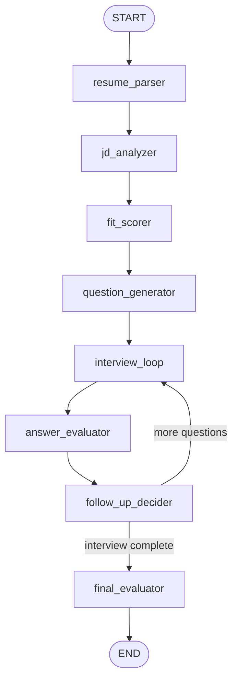
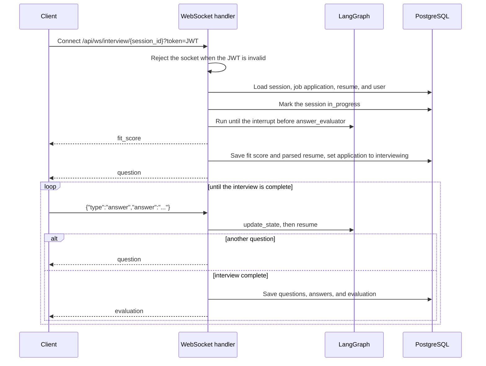

# IntelliPrep — Backend

[](https://github.com/raosam23/intelli-prep-backend/actions/workflows/ci.yml)

FastAPI backend for [IntelliPrep](https://github.com/raosam23/intelli-prep-frontend), an AI interview-prep app. A candidate uploads a resume, pastes a job description, and practices a mock interview. A LangGraph workflow parses both documents, scores how well the resume fits the role, asks tailored questions over a WebSocket, grades each answer, and finishes with a hiring verdict and improvement tips.

The Next.js client lives in a separate repository: [raosam23/intelli-prep-frontend](https://github.com/raosam23/intelli-prep-frontend).

## Features

- Account registration, login, profile updates, and a current-user endpoint. Passwords are hashed with bcrypt and sessions use JWTs.
- Resume upload, replace, list, fetch, and delete. PDF text is extracted with pdfplumber.
- Job applications tied to one resume and a raw job description, with a status of `applied`, `interviewing`, `approved`, or `rejected`.
- Interview sessions with a question count, difficulty (`junior`, `mid`, `senior`), type (`technical`, `behavioral`, `managerial`, `mixed`), and an optional focus area.
- A LangGraph interview agent that pauses before each answer so the WebSocket handler can collect it.
- A dashboard of application counts, fit-score history, and interview score trends.
- Alembic migrations and a Docker image for running the API.

## Architecture

The agent is a `StateGraph` compiled with an in-memory checkpointer. It interrupts before `answer_evaluator`, which is the point where the WebSocket handler writes the candidate's answer back into the graph and resumes.



What each node does:

| Node | Role |
| --- | --- |
| `resume_parser` | Turns raw resume text into structured JSON. |
| `jd_analyzer` | Pulls title, skills, responsibilities, and focus areas out of the job description. |
| `fit_scorer` | Scores the resume against the job from 0 to 100, with a skills, experience, and education breakdown. |
| `question_generator` | Writes the planned questions for the requested count, difficulty, type, and focus area. |
| `interview_loop` | Selects the question at the current index. |
| `answer_evaluator` | Scores the latest answer from 0 to 100 and writes feedback. |
| `follow_up_decider` | May insert one follow-up, then advances the index or marks the interview complete. |
| `final_evaluator` | Produces communication, technical, problem-solving, and overall scores, a verdict, and improvement tips. |

Follow-ups are capped at two in a row. The model has to ask for one, and the previous answer score has to be below 60. A follow-up is stored with an order such as `1.1` or `1.2` so it sits between the planned questions.

Verdicts are `strong_hire`, `hire`, `no_decision`, `no_hire`, and `strong_no_hire`. `hire` and `strong_hire` mark the job application `approved`. `no_hire` and `strong_no_hire` mark it `rejected`. `no_decision` leaves it `interviewing`.

The model is `gpt-4o-mini` at temperature 0, via LangChain's `ChatOpenAI`.

### WebSocket flow

`POST /api/interview-sessions/` creates a `pending` session. The client then connects to the socket. Only a `pending` session can start. `completed` and `in_progress` sessions are rejected.



If the client disconnects or the run fails, the session is marked `incomplete` and the job application is set back to `applied`.

## Tech stack

| Layer | Choice |
| --- | --- |
| API | FastAPI, Uvicorn |
| Agent | LangGraph, LangChain OpenAI |
| Database | PostgreSQL through asyncpg |
| ORM and migrations | SQLModel, SQLAlchemy asyncio, Alembic |
| Auth | python-jose (JWT) and bcrypt |
| PDF text | pdfplumber |
| Packaging | uv, Python 3.12+ |

## Project structure

```
app/
├── agents/           # LangGraph state, nodes, output schemas, and the compiled graph
├── api/
│   ├── routes/       # REST handlers
│   └── websocket/    # Live interview socket
├── core/             # Settings and the ChatOpenAI client
├── db/               # Async engine and session
├── models/           # SQLModel tables
├── schemas/          # Pydantic request and response models
├── services/         # Business logic
└── utils/            # Password hashing and JWT helpers
alembic/              # Migrations
tests/                # Pytest suite (no network, no real keys)
.github/workflows/    # CI
```

## Setup

Requirements: Python 3.12+, [uv](https://docs.astral.sh/uv/getting-started/installation/), and PostgreSQL.

```bash
git clone https://github.com/raosam23/intelli-prep-backend.git
cd intelli-prep-backend
uv sync
cp .env.example .env
```

Fill in `DATABASE_URL`, `SECRET_KEY`, and `OPENAI_API_KEY`. Then apply migrations and start the API:

```bash
uv run alembic upgrade head
uv run uvicorn app.main:app --reload
```

The API listens on `http://localhost:8000`. Interactive docs are at `http://localhost:8000/docs`. The browser client is expected at `http://localhost:3000`; CORS allows that origin, plus `http://localhost:8000`.

Docker builds the same app without dev dependencies:

```bash
docker build -t intelliprep-backend .
docker run --env-file .env -p 8000:8000 intelliprep-backend
```

### Environment variables

| Variable | Required | Default | Purpose |
| --- | --- | --- | --- |
| `APP_NAME` | Yes | | FastAPI title |
| `APP_ENV` | No | `development` | Environment name |
| `DEBUG` | Yes | | SQLAlchemy SQL echo and FastAPI debug |
| `DATABASE_URL` | Yes | | Async URL, `postgresql+asyncpg://...`. Alembic uses the same value |
| `SECRET_KEY` | Yes | | JWT signing secret |
| `ALGORITHM` | Yes | | JWT algorithm, typically `HS256` |
| `ACCESS_TOKEN_EXPIRE_MINUTES` | No | `30` | Access token lifetime |
| `SALT_ROUNDS` | No | `12` | bcrypt cost |
| `OPENAI_API_KEY` | Yes | | Key for the interview agent |

## API

REST routes are under `/api`. Protected routes expect `Authorization: Bearer <token>`. A missing or invalid token returns `401`.

### Health

| Method | Path | Auth | Description |
| --- | --- | --- | --- |
| `GET` | `/health` | No | Returns `{"status": "ok"}` |

### Authentication — `/api/auth`

| Method | Path | Auth | Description |
| --- | --- | --- | --- |
| `POST` | `/api/auth/register` | No | Create an account. Password must be at least 8 characters |
| `POST` | `/api/auth/login` | No | Returns `{access_token, token_type}` |
| `GET` | `/api/auth/me` | Yes | Current user |
| `PUT` | `/api/auth/profile` | Yes | Update name, password, or both |

### Resumes — `/api/resumes`

| Method | Path | Auth | Description |
| --- | --- | --- | --- |
| `POST` | `/api/resumes/upload` | Yes | Multipart field `file`: a PDF |
| `GET` | `/api/resumes/` | Yes | Resumes for the current user |
| `GET` | `/api/resumes/{resume_id}` | Yes | One resume |
| `PUT` | `/api/resumes/{resume_id}` | Yes | Multipart field `new_file`: replacement PDF |
| `DELETE` | `/api/resumes/{resume_id}` | Yes | Delete a resume |

Stored `parsed_json` is returned as an object. It is filled when an interview runs, not at upload time. Upload stores the extracted text.

### Job applications — `/api/job-applications`

| Method | Path | Auth | Description |
| --- | --- | --- | --- |
| `POST` | `/api/job-applications/` | Yes | Body: `resume_id`, `jd_raw_text` |
| `GET` | `/api/job-applications/` | Yes | List the current user's applications |
| `GET` | `/api/job-applications/{application_id}` | Yes | One application |
| `PUT` | `/api/job-applications/{application_id}` | Yes | Update `status` and/or `jd_raw_text` |
| `DELETE` | `/api/job-applications/{application_id}` | Yes | Delete an application |

The resume must belong to the caller. A new application starts as `applied`.

### Interview sessions — `/api/interview-sessions`

| Method | Path | Auth | Description |
| --- | --- | --- | --- |
| `POST` | `/api/interview-sessions/` | Yes | Create a `pending` session |
| `GET` | `/api/interview-sessions/job-application/{job_application_id}` | Yes | Sessions for one application |
| `GET` | `/api/interview-sessions/{interview_session_id}` | Yes | One session |
| `DELETE` | `/api/interview-sessions/{interview_session_id}` | Yes | Delete a `pending` or `incomplete` session |

Create body:

```json
{
  "job_application_id": "uuid",
  "num_questions": 5,
  "difficulty": "mid",
  "interview_type": "mixed",
  "focus_area": "system design"
}
```

`num_questions` must be at least 1. `focus_area` is optional. Sessions that are `in_progress` or `completed` cannot be deleted.

### Analytics — `/api/analytics`

| Method | Path | Auth | Description |
| --- | --- | --- | --- |
| `GET` | `/api/analytics/dashboard` | Yes | Totals, status counts, fit-score trend, and score averages |

Averages skip null scores. With no data, averages are `0`.

### Interview WebSocket — `/api/ws/interview/{session_id}`

Connect with a valid JWT in the query string:

```
ws://localhost:8000/api/ws/interview/{session_id}?token=<jwt>
```

An invalid token closes the socket with code `4001` before it is accepted.

Client messages:

```json
{ "type": "answer", "answer": "Your answer text" }
```

Any other `type` is ignored.

Server messages:

| `type` or shape | When |
| --- | --- |
| `{"error": "..."}` | The session, job, resume, or user cannot be loaded, or the session is not `pending` |
| `{"type": "fit_score", "fit_score", "fit_breakdown"}` | After the graph prepares the interview |
| `{"type": "question", "question", "question_number", "total_questions"}` | Each question, including follow-ups |
| `{"type": "evaluation", "final_evaluation"}` | The interview is complete |
| `{"type": "error", "message"}` | The run failed after the socket was accepted |

`final_evaluation` contains `communication_score`, `technical_score`, `problem_solving_score`, `overall_score`, `verdict`, and `improvement_tips`.

## Testing

The suite is pytest. It does not need Postgres, OpenAI, or any other network service. `tests/bootstrap.py` sets dummy environment variables when they are not already present, and CI sets the same placeholders.

```bash
uv sync
uv run pytest
uv run pytest --cov=app --cov-report=term-missing
uv run ruff check . --exclude alembic/ --select=E,F --ignore=E501,F821
uv run pyright
```

| Area | What is covered |
| --- | --- |
| `tests/test_security.py` | bcrypt hashes and JWT create, decode, tamper, and expiry |
| `tests/test_schemas.py` | Auth, interview, and agent output validation |
| `tests/test_dependencies.py` | `get_current_user` success, bad token, unknown user |
| `tests/test_config_and_database.py` | Settings defaults, session dependency, `init_db` |
| `tests/test_auth_service.py` | Register, login, and profile updates |
| `tests/test_resume_service.py` | PDF extraction, ownership, replace, delete |
| `tests/test_job_application_service.py` | Create, list, update, delete, ownership |
| `tests/test_interview_session_service.py` | Session rules, including which statuses can be deleted |
| `tests/test_analytics_service.py` | Empty dashboard and score averages |
| `tests/test_api_routes.py` | REST routes through `TestClient` |
| `tests/test_agent_nodes.py` | Every LangGraph node, including follow-up rules |
| `tests/test_agent_graph.py` | Compiled edges and the interrupt before `answer_evaluator` |
| `tests/test_websocket.py` | The live interview socket |

Mocking:

| Dependency | How |
| --- | --- |
| Database | `AsyncMock` session, or a small in-memory session double for the socket |
| FastAPI dependencies | `app.dependency_overrides` for `get_session` and `get_current_user` |
| OpenAI / LangChain | The prompt chain's `ainvoke` is an `AsyncMock`. The graph topology tests never call the model |
| pdfplumber | `open` returns pages with scripted text |
| Startup | `init_db` is patched so `TestClient` does not connect |

## CI

`.github/workflows/ci.yml` runs on pushes and pull requests to `main`. Lint, type checking, and tests are separate jobs, so a failure in one is visible on its own. Each job installs dependencies with `uv sync --frozen` (the dev group is included by default).

| Job | What it runs |
| --- | --- |
| Lint | `ruff check` for pycodestyle and pyflakes (`E501` and `F821` ignored, Alembic excluded). `ruff format --check` is allowed to fail without failing the job. |
| Type Check | `pyright`, allowed to fail without failing the job. |
| Test | `pytest` with coverage of `app`. The job fails if coverage drops below 95%. |
